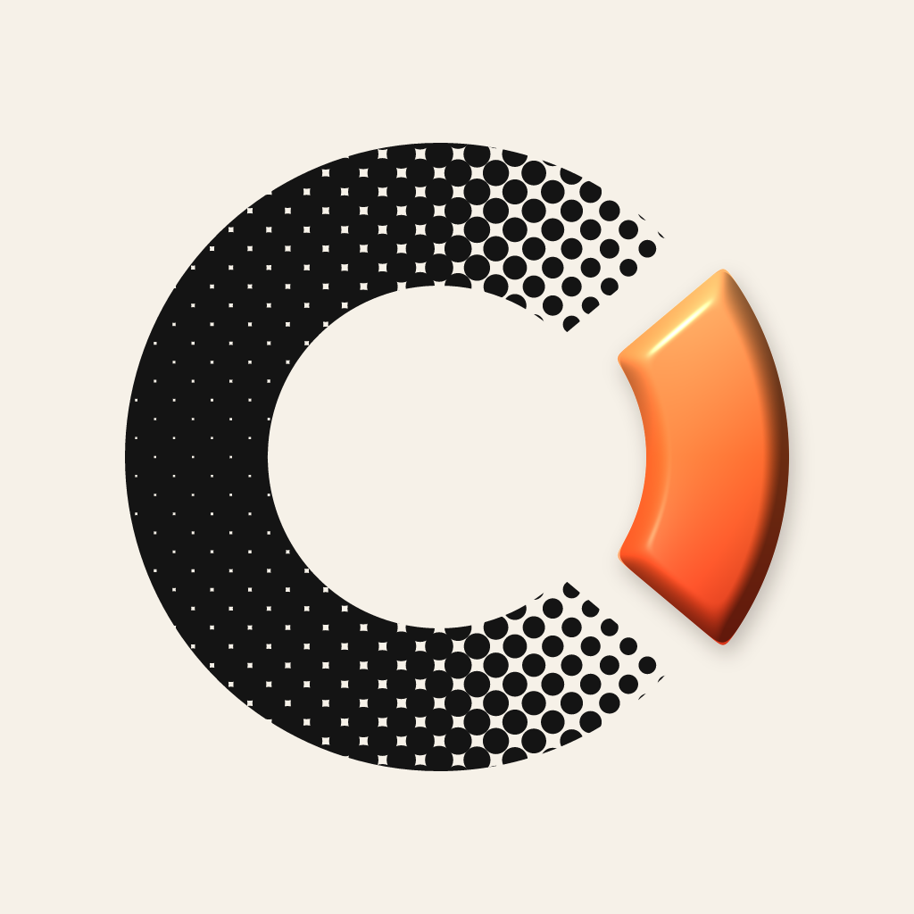

  <picture>
    <source media="(prefers-color-scheme: dark)" srcset="https://github.com/getcurate/.github/raw/main/brand/curate-mark-ink-1024.png">
    
  </picture>

Sam and Aiden. We build tools and open-source them.

**[ReelStudio](https://github.com/getcurate/reel-studio)** turns a raw talking-head video into a finished, captioned Reel. Desktop app, AGPL-3.0, [signed builds](https://getreelstudio.com).

oss@curateapp.dev
